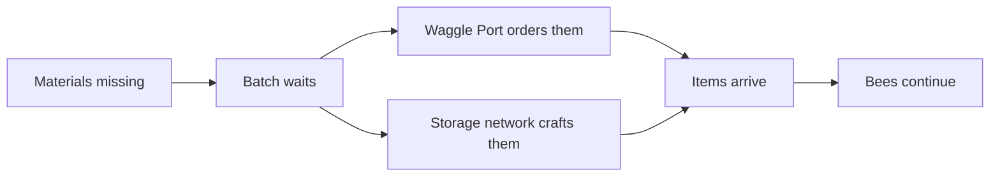
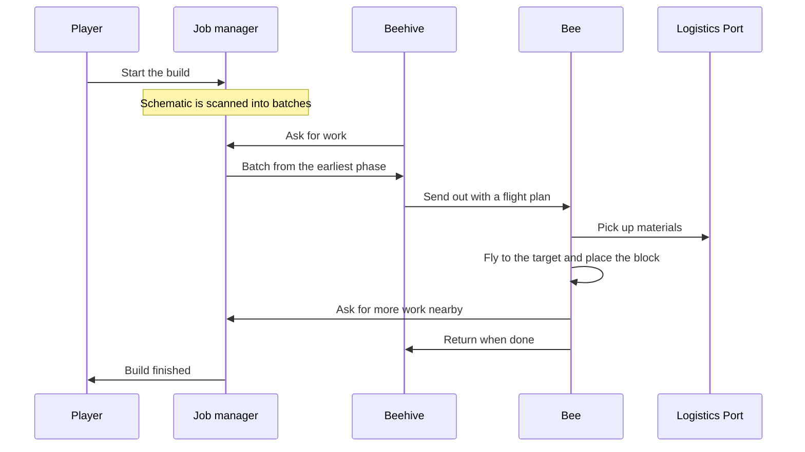

You don't need this page to add compat. It explains what happens inside Buzzy Beez, so you know where your code runs.
Everything here is internal and can change between versions.

## How to handle 10,000 bees

### The idea

When looking at Buzzy Beez you might think Beez are actually real entities. But having 10,000 entities in such a small
area would crash any kind of server. To not be stuck with a limit of, say, 100 Beez, Buzzy Beez does not use entities.

Beez are small data points instead. The server does not even know what a bee looks like, or exactly where it is. It just
knows where it starts, where it ends and how long it takes. This information is shared with the client, which then
renders the bees.

The main challenge is keeping this information as small as possible, so the network load stays acceptable.

Because 10,000 Beez still eat a good amount of performance, Buzzy Beez uses adaptive tick usage. Each expensive step
gets a time budget per tick. Placing and breaking blocks gets more time while the server has capacity, and less as soon
as the average tick takes longer than 30 ms, well before TPS drops below 20.

| Step                                                            | Budget per tick                                |
|-----------------------------------------------------------------|------------------------------------------------|
| Placing and breaking blocks                                     | 5 ms, grows while the server has time to spare |
| Other [bee stops](#flights), like picking up items              | 3 ms                                           |
| [Scanning schematics into tasks](#how-schematics-are-converted) | 15 ms                                          |

All budgets can be changed in the [config](../../config/#performance).

### Flights

Because bees are not entities, they don't have a brain telling them what to do. Instead, the server calculates a
so-called flight plan whenever a bee needs to go somewhere. A flight plan usually consists of:

- Start and end
- How long the flight takes
- What to do on arrival, such as running a [`BeeAction`](#jobs-batches-and-actions)

This plan is then shared with the client, which handles rendering the bee.

## Networks

Buzzy Beez introduces BeeNetworks, which bees operate inside of. A BeeNetwork is similar to a Wi-Fi network: it has
anchors, extenders, and devices that bees can use. [Beehives](#beehive) are the anchors, and every other beehive in
range joins the same network and extends it. [Ports](#storage) are the devices.

### Beehive

A Mechanical Beehive gets its strength from rotation. At 0 RPM it does nothing. The faster it turns, the larger its
range, the more bees it sends out at once, and the faster they fly. The exact numbers are in the
[config](../../config/#beehive).

The Portable Beehive is worn on the player's back and has its own network around the player. It runs on
[honey](../../config/#honey_fuel) instead of rotation, and upgrades on its grid make it stronger. It can also take
materials from the player's inventory, but only after every [Logistics Port](#storage).

### Storage

Beez don't look into every chest nearby. They only use what's behind a port, so the player decides what they may take
and where they put what they break.

Logistics Ports handle both. A port either gives items to bees or takes items from them, and each one has a filter and a
priority. Bees pick the port with the highest priority first, then the one with the shortest detour. Dock Ports do the
same for fluids.

Behind each port is a [storage](../compat/#custom-storages): a normal inventory, or a whole storage network like AE2 or
Refined Storage.

The main challenge here is many bees wanting the same items at once. So when a bee [plans its flight](#flights), it
reserves what it needs, and two bees never fly to the same stack.

Transport Ports are separate from building. They move items from one inventory to another, using Bumble Bees. Ports with
the same frequency items are paired.

### Waggle Port

Sometimes the network simply doesn't have the materials a [job](#jobs-batches-and-actions) needs. Without help, the job
would wait until the player brings them by hand.

The Waggle Port fixes that. It is linked to Create's stock network and orders what's missing, the same way a Stock
Keeper would. Its timing is in the [config](../../config/#waggle_port). [Storage networks](#storage) that can craft are
asked to craft the missing items as well.

The Waggle Port only orders what the stock network has and what nobody has ordered yet. If an order doesn't arrive in
time, it orders again.

## Building schematics

### How schematics are converted

Before bees can build, the schematic is turned into [work they can pick up](#jobs-batches-and-actions). A schematic can
have hundreds of thousands of blocks, so this scan is spread over several ticks. Each block is compared to what's in the
world:

- If the right block is already there, it's skipped.
- If something else is in the way, it's removed first.
- Otherwise, the block is placed.

This is also where [substitutes](../compat/#unplaceable-blocks) swap blocks that can't be placed as they are, and where
rotated or mirrored blocks go through your [transforms](../compat/#custom-rotation).

### Jobs, batches and actions

Each block that needs work becomes a task. A task holds a `BeeAction`, which is the actual work: placing a block,
breaking one, placing a fluid, or dropping off items.

Tasks are grouped into batches, and a bee works on one batch at a time, in a single [flight](#flights). Most batches
have one task. Tasks that belong together share a batch, for example a belt and its shafts, or breaking a block and
dropping off what it left.

All batches of one build form a job. If bees just placed blocks in any order, sand would fall before the blocks below it
exist, and water would flood half-built rooms. So each batch has a phase, and a phase only starts after every batch in
the phase before it is done:

The last phase is for finishing actions, such as forming multiblocks once all their parts are there.

Jobs are saved with the world. Bees aren't: after a restart, every batch that was in progress goes back to the [job
manager](#the-job-manager). That's why custom actions need a [codec](../compat/#custom-bee-actions).

### History

Beez can change thousands of blocks in a minute, so a mistake can be big. It needs to be easy to reverse.

Every block a [job](#jobs-batches-and-actions) changes is recorded, together with what was there before. Each player has
20 steps of undo and redo. The history is linear: starting a new job clears the redo steps.

Undo only restores blocks that are still exactly as the job left them. Blocks that changed since then are skipped, and
the player is told how many.

## How bees build

### The job manager

The job manager decides which bee does what. Jobs often reach across several beehives, and several jobs can run at once,
so all jobs are kept in one job pool. Every 2 seconds, and whenever something changes, beehives with free bees ask it
for work. A beehive gets a batch from the nearest job, from the earliest [phase](#jobs-batches-and-actions) it can work
on.

A batch is skipped while something is missing, and the job shows the player why: [no network](#networks), [out of
range](#beehive), no fuel, no bees, [missing materials](#waggle-port), or [nowhere to drop items off](#storage). If no
beehive can reach a batch, the batch is put aside. It goes back into the queue once a beehive can reach it, for example
after the player speeds up the [beehive](#beehive).

### An example

A player builds a small house with the Construction Planner. A Mechanical Beehive is nearby, and a chest of materials
sits behind a Logistics Port.

1. The player confirms the placement. The schematic is [scanned](#how-schematics-are-converted), and the grass where the
   house stands becomes removal tasks.
2. The job joins the [job pool](#the-job-manager). The beehive asks for work and gets the removal batches first.
3. Bees break the grass and drop it off at the [Logistics Port](#storage).
4. Once every removal is done, the placement [phase](#jobs-batches-and-actions) starts. A bee [reserves](#storage)
   planks at the port, picks them up, and places them one by one.
5. The chest has no glass. The window batches wait, and the [Waggle Port](#waggle-port) orders glass from the stock
   network.
6. The glass arrives and the windows are placed.
7. The last batch finishes. The player hears a chime, and the build can be [undone](#history) or removed later.
